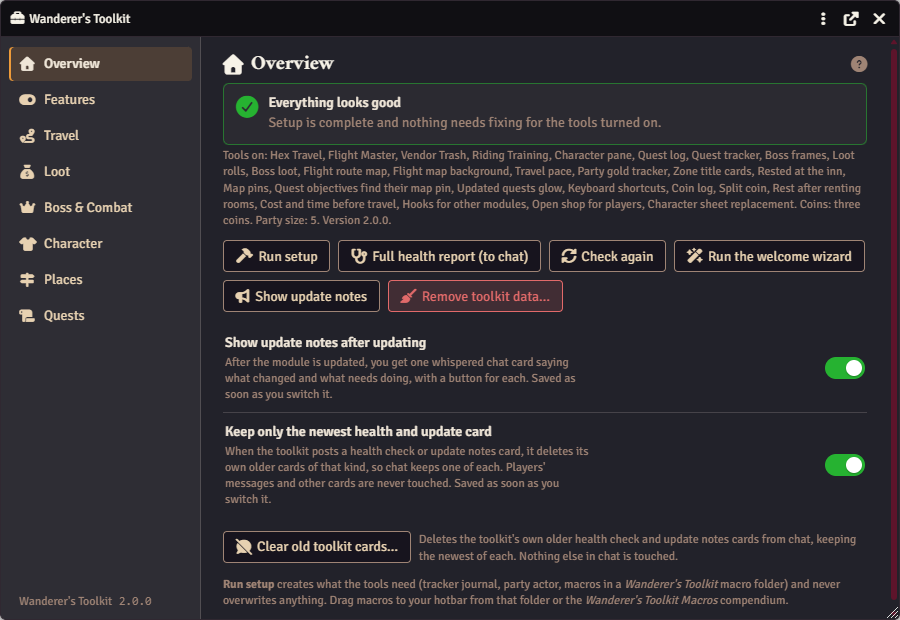
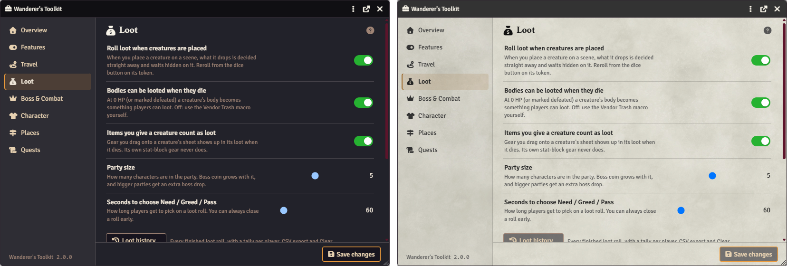

# Wanderer's Toolkit

A free GM kit for [Foundry VTT](https://foundryvtt.com) and **D&D 5e**: travel and flights, junk loot and loot rolls, a quest log, a character pane, boss frames, inns, map pins and a three-coin economy, each one switched on or off per world.

> Formerly *Wayfarer's Toolkit*. Only the display name changed: the module id (`wayfarers-toolkit`), settings, API and hooks are the same, and your worlds need nothing done.

## Requirements

- **Foundry VTT** 13 or later (verified on 14).
- **dnd5e** system 5.0.0 or later (verified on 6.0.6). It doesn't run on other systems.
- Optional, none required: **[Item Piles](https://foundryvtt.com/packages/item-piles)** with **Item Piles: D&D 5e** (lootable bodies, loot rolls, merchants), **Red Book** (loot history by session), **Monk's Active Tiles** (tiles can call the toolkit), and a classic-MMO item compendium module (package id `wow-classic-items`; junk loot, slots and quality colours come from its items). Nothing from those modules is bundled.

## Install

In Foundry's setup screen, go to **Add-on Modules → Install Module** and paste this manifest URL:

```
https://github.com/cocoomg11/wayfarers-toolkit/releases/latest/download/module.json
```

## Contents

- [Quick start](#quick-start) · [Tools at a glance](#tools-at-a-glance) · [The Wanderer's family](#the-wanderers-family)
- [Settings](#settings) (the [control panel](#control-panel) and its tabs) · [Troubleshooting](#troubleshooting) · [Removing the toolkit's data](#removing-the-toolkits-data)
- Guides: [Travel](docs/travel.md) · [Loot and coins](docs/loot-and-coins.md) · [Quests and characters](docs/quests-and-characters.md) · [Places](docs/places.md) · [Scripting and data](docs/scripting.md)
- [For developers](#for-developers) · [License](#license) · [Changelog](CHANGELOG.md)

## Quick start

You need a world that uses the **dnd5e** system, and you need to be the GM.

1. **Enable it.** In your world, go to **Game Settings › Manage Modules**, tick **Wanderer's Toolkit** and save. Foundry reloads.
2. **Answer the welcome wizard.** It asks for a style (*Minimal*, *Classic MMO* or *Everything*), your party size and your coin system. Click **Finish (reloads Foundry)**, then say yes to **Run setup**: it makes the tracker journal, the party actor and the macros. (Skipped it? Open the [control panel](#control-panel) and use **Run the welcome wizard** or **Run setup** on the Overview tab.)
3. **Check the control panel.** **Overview** should say "Everything looks good"; if not, each problem has a button that fixes it. On **Features**, switch off tools you won't use and click **Save features**.
4. **Grab your macros.** In the **Macro Directory**, open the *Wanderer's Toolkit* folder and drag the ones you want onto your hotbar. Setup never touches a hotbar.
5. **Try one thing.** Press **L** for the quest log and click **New quest**; or click the shirt button on a character sheet for the character pane; or place a few NPC tokens, reduce one to 0 HP and loot its body.
6. **Optional:** install **Item Piles** and **Item Piles: D&D 5e** for lootable bodies, loot rolls and merchants. See [Setting up Item Piles](docs/loot-and-coins.md#setting-up-item-piles).



## Tools at a glance

Every tool has its own switch on the control panel's **Features** tab. All are on by default except the three-coin economy (coins start as standard 5e).

| Tool | What it does | Switch on the Features tab |
| --- | --- | --- |
| [Hex Travel](docs/travel.md#hex-travel) | Road and off-road hexes at a pace; off-road hexes roll for encounters on the zone's table. Moves world time and logs the trip. | *Hex Travel* |
| [Flight Master](docs/travel.md#flight-master) | Fly the party between unlocked flight points on the cheapest route; fares come out of the party purse. Players can book too. | *Flight Master* |
| [Flight route map](docs/travel.md#route-map) | The flight network drawn as a map; players see the points they've unlocked. | *Flight route map* |
| [Flight map background](docs/travel.md#map-background) | Your own picture behind the route map. | *Flight map background* |
| [Travel pace](docs/travel.md#travel-pace) | Fast, normal or slow pace for Hex Travel, with each pace's effect on checks (SRD 5.2). | *Travel pace* |
| [Riding Training](docs/travel.md#riding-training-and-long-road) | A riding feat; when the whole party has it, Hex Travel goes mounted. | *Riding Training* |
| [Cost and time before travel](docs/travel.md#cost-and-time-before-travel) | Shows cost, time and who pays before a trip or flight. | *Cost and time before travel* |
| [Vendor Trash](docs/loot-and-coins.md#vendor-trash) | Grey junk loot rolled on every NPC token, matched to the creature and its CR; bodies become lootable when they die. | *Vendor Trash* |
| [Open shop for players](docs/loot-and-coins.md#open-shop-for-players) | Open an Item Piles merchant on the players' screens, each with their own character. | *Open shop for players* |
| [Merchant coin rounding](docs/loot-and-coins.md#merchant-coin-rounding) | Item Piles merchant prices round to a whole coin, so a cheap item at a discount isn't free. Off by default. | *Merchant coin rounding* |
| [Loot rolls](docs/loot-and-coins.md#loot-rolls) | Need / Greed / Pass for an item in a pile, with a GM-only loot history. | *Loot rolls* |
| [Boss loot](docs/loot-and-coins.md#boss-loot) | Link a roll table of hand-picked drops to a creature; it's drawn when the creature dies. | *Boss loot* |
| [Party gold tracker](docs/loot-and-coins.md#party-gold-tracker) | GM only: the party's coin against a wealth curve. | *Party gold tracker* |
| [Three-coin economy](docs/loot-and-coins.md#three-coin-economy-copper-silver-gold) | Copper, silver and gold only, 100 to 1. | *Three-coin economy* |
| [Coin log](docs/loot-and-coins.md#coin-log-and-split-coin) | GM only: every coin movement the toolkit makes, with Undo. | *Coin log* |
| [Split coin](docs/loot-and-coins.md#coin-log-and-split-coin) | Share the party actor's coin among its members. | *Split coin* |
| [Quest log](docs/quests-and-characters.md#quest-log) | Narrative quests with objectives, rewards and parties, in an MMO-style log (key **L**). | *Quest log* |
| [Quest tracker](docs/quests-and-characters.md#what-players-see) | An on-screen list of tracked quests and their open objectives. | *Quest tracker* |
| [Quest objectives find their map pin](docs/quests-and-characters.md#what-players-see) | Click an objective to move the map to the quest's pin. | *Quest objectives find their map pin* |
| [Updated quests glow](docs/quests-and-characters.md#what-players-see) | A changed quest glows for players until they open it. | *Updated quests glow* |
| [Character pane](docs/quests-and-characters.md#character-pane) | A classic-MMO-style character sheet with gear slots, weapon sets and comparison tooltips. | *Character pane* |
| [Character sheet replacement](docs/quests-and-characters.md#character-sheet-replacement) | Off by default, in progress: the toolkit's own dark sheet for player characters (key **C**), run by dnd5e's rules; GMs can always open the system sheet. | *Character sheet replacement* |
| [Boss frames](docs/quests-and-characters.md#boss-frames) | Health frames at the top of the screen for marked bosses in combat, with phase marks. | *Boss frames* |
| [Keyboard shortcuts](docs/quests-and-characters.md#keyboard-shortcuts) | Configure Controls entries for the character sheet (C), the character pane and the control panel. | *Keyboard shortcuts* |
| [Zone title cards](docs/places.md#zone-title-cards) | A scene's title fades in over the map when it's activated. | *Zone title cards* |
| [Rested at the inn](docs/places.md#rested-at-the-inn) | Inns with room prices; renting makes the party Rested for a bonus on the next long rest. | *Rested at the inn* |
| [Rest after renting rooms](docs/places.md#rested-at-the-inn) | Long-rest everyone who rented in one click. | *Rest after renting rooms* |
| [Map pins](docs/places.md#map-pins) | The party's own inked marks on any scene, with notes and quest links. | *Map pins* |
| [Hooks for other modules](docs/scripting.md#hooks) | Foundry hooks when quests change and when the party travels. | *Hooks for other modules* |

## The Wanderer's family
Five free modules that work on their own and fit together. Each one switches on only what you use.

| Module | What it does |
|---|---|
| [Wanderer's Toolkit](https://github.com/cocoomg11/wayfarers-toolkit) | GM kit for D&D 5e: quest log, travel and flights, inns, loot rolls, boss frames, a three-coin economy. |
| [Red Book](https://github.com/cocoomg11/red-book) | Session prep: a live session log, next-session board, scene readiness check, Session Start. |
| [Wanderer's Satchel](https://github.com/cocoomg11/wanderers-satchel) | Optional hub: one window for the family, update check, combined health check, settings backup. |
| [Ringmaker](https://github.com/cocoomg11/ringmaker) | Your own ring image for Foundry's dynamic token rings. Any game system. |
| [Loot Ledger](https://github.com/cocoomg11/loot-ledger) | Priced, rollable loot pools and roll tables for D&D 5e, built from a classic-MMO item compendium. |

They share one look that follows Foundry's light and dark themes. None of them needs the others.

## Settings

Every tool can be turned off. A tool that's switched off adds nothing: no buttons, macros, key bindings, chat buttons, hooks or sheet changes. Its settings stay visible but greyed out, and nothing already in your world is deleted, so switching it back on picks up where it left off.

### Control panel



All of the toolkit's settings live in one window: **Game Settings → Configure Settings → Wanderer's Toolkit → Open the control panel** (GM only). The only other entry in the module's settings list is **Show the quest tracker on my screen**, which each player sets for themselves.

The panel has eight tabs down the left side (arrow keys, Home and End move between them). Each settings tab shows the settings most GMs change first; the rest are in a collapsed **Advanced** section. Each tab has a **?** link to its part of this README and a **Reset this tab to defaults** button (asks first; not on Features). Change what you like, then click **Save changes**. Settings keep their names from earlier versions, so anything you set before is still set.

**Setup.** **Run setup** (Overview tab) creates anything missing: the tracker journal, the party actor, the Riding Training feat and the macros in a *Wanderer's Toolkit* macro folder. It never overwrites your documents and never touches a hotbar.

**Macros.** The module ships a **Wanderer's Toolkit Macros** compendium (in a *Wanderer's Toolkit* compendium folder) with every macro Run setup makes: Hex Travel, Flight Master, Flight Route Map and Travel Pace (*Travel*), Quest Log (*Sessions and Quests*), Rent Rooms (*Places*), Vendor Trash, Preview Vendor Trash and Sell Vendor Trash (*Vendor Trash*), Preview Boss Loot (*Boss Loot*), Loot History (*Loot Rolls*), and Party Gold and Toolkit Health Check (*Toolkit*). Each is made only while its tool is on. Open it from the **Compendium Packs** sidebar and drag a macro onto your hotbar; Foundry imports a copy into your world. **Run setup** also creates world copies in a *Wanderer's Toolkit* macro folder (Macro Directory). Setup doesn't touch any hotbar, so drag the macros you want from that folder or from the compendium onto your hotbar.

Players can see the compendium (Observer), so they can drag out **Flight Master** and **Quest Log** themselves. The other macros are GM tools: a player who runs one gets a "GM only" warning and nothing happens. A compendium can't hide entries per world, so macros for tools you've switched off in the control panel are still listed; running one only shows the "turned off" warning. Each macro is a one-line call into the module API, so the compendium copies never go stale between versions.

**Look.** Every toolkit window, dialog and chat card uses the shared look of the Wanderer's modules and follows Foundry's dark or light theme. A few things look the same in both themes on purpose: the character sheet, the on-screen quest tracker, boss frames, and the quest log's list and page.

### Overview tab

A plain-language health summary built from the [health check](docs/scripting.md#health-report-what-it-checks): "Everything looks good", or "N things need attention" with one line per problem and, where there's a quick fix, a button: **Run setup** for anything setup hasn't made yet, **Link boss tables by name** for creatures with an unlinked table, a jump to the Travel tab for encounter zones or the Loot tab for compendiums, opening the flight network editor (or **Import from the Flight Routes journal page** when that's waiting), or opening the Vendor Trash Rules page. Below it: **Run setup**, **Full health report (to chat)** (the full ✓ / ⚠ / ✗ card), **Check again**, **Run the welcome wizard**, **Show update notes** and **Remove toolkit data…**, and the **Show update notes after updating** switch (saved as soon as you flip it; see [Update notes](docs/scripting.md#update-notes)).

### Features tab

One card per tool, with a switch: Hex Travel, Flight Master, Vendor Trash, Riding Training, Character pane, Quest log, Quest tracker, Boss frames, Boss loot, Loot rolls, Flight route map, Travel pace, Party gold tracker, Zone title cards, Rested at the inn, Map pins and the Three-coin economy. All tools are on by default (the coins start on standard 5e). **Save features (reloads Foundry for everyone)** applies them.

A tool that's switched off adds nothing: no buttons, macros, key bindings, chat buttons, hooks or sheet changes (the character pane's armour-class adjustment included). Its settings stay in the other tabs, greyed out with a note, so you can see them. **Run setup** skips its macros and items. Nothing already in your world is deleted, so switching a tool back on picks up where it left off. Calling a switched-off tool from a macro just shows a warning.

### Travel tab

| | Settings |
| --- | --- |
| **Basics** | **Encounter zones** (a table: zone name and the roll table its encounters come from, with **Add zone** and a remove button per row; problems such as a missing name, a zone listed twice or a table that doesn't exist show under the table), **Players can book flights**, **Fares without a coin are in** (gold, silver or copper), the **Flight network…** button (the [flight network editor](docs/travel.md#the-flight-network-editor)) |
| **Advanced** | **Announce new flight points** (on), **Flights advance world time** (off), **Locked flight points on players' map** (hidden or greyed), **Zoom and pan the route map** (on), **Players can ask for a travel pace** (on), encounter die, off-road time multiplier, mounted speed multiplier, slow / normal / fast pace, departure sound and its volume, riding feat name, tracker journal and party actor (pick from your journals and group actors, or type a name) |

With the route map and travel pace on, the tab also has **Flight route map…** and **Travel pace…** buttons.

### Loot tab

| | Settings |
| --- | --- |
| **Basics** | **Roll loot when creatures are placed**, **Bodies can be looted when they die**, **Items you give a creature count as loot**, **Party size** (1–8, see [Boss loot](docs/loot-and-coins.md#boss-loot)), **Seconds to choose Need / Greed / Pass**; and a **Loot history…** button (see [Loot history](docs/loot-and-coins.md#loot-history)) |
| **Advanced** | **Party is in act / tier**, **Wealth curve (gold per character)**, **Count mundane gear in party wealth** (off) (see [Party gold tracker](docs/loot-and-coins.md#party-gold-tracker)), **Keep a loot roll history** (on), **Sell all junk button** (on; see [Sell all junk](docs/loot-and-coins.md#sell-all-junk-at-a-merchant)), **Merchant prices round** (nearest whole coin; see [Merchant coin rounding](docs/loot-and-coins.md#merchant-coin-rounding)), unconscious creatures can be looted, loot stays on the body (Item Piles), the three dungeon settings, **Where junk loot comes from** (tick item compendiums by name), keep Item Piles' coins in step (three-coin economy), [debug logging](#debug-logging), **Show module data folder** (just for you; see [GM-only data](#where-the-toolkit-keeps-gm-only-records)); and a **Reset window positions** button (see [Windows](docs/quests-and-characters.md#windows-and-shortcuts)) |

### Boss & Combat tab

| | Settings |
| --- | --- |
| **Basics** | **Boss health players see** (bar only, bar and percentage, exact HP), **Show phase marks to players** (off; see [Phase marks](docs/quests-and-characters.md#phase-marks)), **Boss loot drops on death**, **Creatures with boss loot get a boss frame**; and a **Link boss tables by name** button |
| **Advanced** | Extra boss drop for parties over 4 |

### Character tab

| | Settings |
| --- | --- |
| **Basics** | **Weapon sets** (on by default), **Weapon swap cost** (Free, Part of an attack, Object interaction, Bonus action, Action; default Part of an attack), **Classes with a relic slot** (a checklist of the classes in your world; Paladin, Druid and Cleric to start with), **Item comparison tooltips** (on; see [Item comparison](docs/quests-and-characters.md#item-comparison)) |

Greyed out while the character pane is switched off. See [Weapon sets](docs/quests-and-characters.md#weapon-sets).

### Places tab

| | Settings |
| --- | --- |
| **Basics** | **Title cards show** (when a scene is activated, or every time a scene is viewed), **Title cards are seen by** (everyone, or players only), **Room price per person per night** (5s by default), **Rested gives** (Heroic Inspiration by default); and **Preview title card** and **Rent rooms…** buttons |
| **Advanced** | Every scene gets a title card (on), seconds on screen, title card style, default title card sound and volume, show a card when the world loads (off), rooms are paid from (party actor), Rested lasts until the next long rest anywhere (on), Rested icon on tokens (off), players can ask for rooms (on), players can place map pins (on), players can change any party pin (on), fade pins of finished quests (on), pin size (40), parchment behind pins (on), show map notes when a scene has pins (on) |

See [Zone title cards](docs/places.md#zone-title-cards) and [Rested at the inn](docs/places.md#rested-at-the-inn). Per-scene options (title card, Dungeon, inns) are in each scene's configuration, [**Table Tools** tab](docs/places.md#table-tools-tab).

### Quests tab

| | Settings |
| --- | --- |
| **Basics** | **Show the quest tracker on my screen** (just for you), **Parties**, **Announce objectives in chat**, sounds when a quest is given and completed |
| **Advanced** | Quest cap, quest sound volume, quest folder |

## Troubleshooting

- **Start with the health check.** The control panel's **Overview** tab lists what needs attention, each with a fix button; **Full health report (to chat)** whispers you every line. It checks setup, Item Piles and coins, boss loot tables, the flight network, encounter zones and the permissions players need for each tool. It changes nothing. [What it checks](docs/scripting.md#health-report-what-it-checks).
- **A GM has to be logged in** for anything players start: flights, pace and room requests, loot roll choices, map pins, long rests at an inn. Automatic steps (rolling junk loot when a token is placed, making bodies lootable, drawing boss loot, settling loot rolls) also run on a GM's client. With several GMs, or one GM in several browser tabs, only one client acts; the health check says which. [More](docs/scripting.md#several-gms-and-gm-tabs).
- **Bodies don't become lootable piles.** Install and enable both **Item Piles** and **Item Piles: D&D 5e**, then reload. Without the add-on, Vendor Trash falls back to a Give to Party card with a warning. [Setting up Item Piles](docs/loot-and-coins.md#setting-up-item-piles).
- **Players can't use a macro.** Players need the *Use Script Macros* permission and Observer on the shared macros (Flight Master, Quest Log, Travel Pace, Flight Route Map); the health check's *Permissions* section lists what's missing. Other macros are GM tools: a player gets a "GM only" warning.
- **A macro says the tool is turned off.** The compendium lists every macro, even for tools you've switched off. Switch the tool on in the Features tab, or ignore that macro.
- **Coins look wrong after switching to three coins.** Platinum and electrum are converted each time the world loads. Item prices are never rewritten. [What it doesn't change](docs/loot-and-coins.md#what-it-doesnt-change).
- **A window is off screen or the wrong size.** Windows remember their place per computer; **Reset window positions** (Loot › Advanced) puts them back. Double-click the quest tracker's title to put it back.
- **Something else.** Turn on [debug logging](#debug-logging) and check the browser console, then [open an issue](https://github.com/cocoomg11/wayfarers-toolkit/issues).

### Debug logging

**Debug logging** (control panel › Loot › Advanced, off by default) writes the toolkit's automatic decisions to the browser console (F12): why a body got no loot, which GM's client ran an automatic step, the creature kind, CR band and items rolled, boss loot draws, and how each loot roll was settled. With it off nothing is logged.

### Update notes

After an update, the GMs get one whispered chat card with what's new and a **To do** list with a button for anything that still needs doing (like **Run setup**). Switch it off with **Show update notes after updating** on the Overview tab; **Show update notes** there posts it again. [More](docs/scripting.md#update-notes).

## Removing the toolkit's data

**Remove toolkit data** (a button on the control panel's Overview tab, GM only) cleans the toolkit out of a world, for example before uninstalling it. The window first counts what it would remove, with a checkbox per kind:

- the toolkit's own data on actors (with the *Rested* status icon, if Rent rooms added one), on tokens on every scene, on scenes (Dungeon, Title card, inns, and the old Hub and Inn marks), on items (world items and items on actors), and on journals, journal pages and roll tables (only the toolkit's data: the documents stay; quest journals stop being quests), plus Hex Travel's trip counter on the tracker journal; with *Delete the GM-only records journal* ticked (off by default), the hidden GM journal *Wanderer's Toolkit (GM only)* (the full flight network, hidden map pins, quest GM text, room rentals, gold snapshots, loot history and the coin log), and the shared *Module data* folder if nothing else is left in it;
- optionally, the toolkit's data on **chat messages** (loot, loot roll, quest, health and update cards; the cards stay but their buttons stop working);
- optionally, **map pins** (the map notes placed with the Map pin tool, on every scene, party and GM pins alike: they're deleted);
- optionally, **items created by the toolkit** (vendor trash and boss loot items, wherever they are: on bodies, the party actor or characters);
- optionally, the **world macros Run setup made**;
- optionally, **reset the module's settings** to their defaults (feature toggles included; Foundry offers to reload).

Type **REMOVE** and click **Remove** (or **Cancel** to close without changes). Nothing else is touched: your own documents, other modules' data and items the toolkit didn't create stay. Item Piles piles stay piles (use Reset loot on them first if you want normal tokens back). What was removed is shown in a notification and whispered to the GMs. Any GM can run it. (From a macro: `api.cleanup.plan()` counts and `api.cleanup.remove({ … })` removes; see [scripting](docs/scripting.md).)

### Map pins

Map pins are ordinary Foundry map notes, so removing the toolkit's flags alone would leave them on your scenes. Tick **map pins** in Remove toolkit data to delete them all, party and GM pins alike (from a macro, the `pins` option of `api.cleanup.remove`). Your own map notes stay. [About map pins](docs/places.md#map-pins).

### Where the toolkit keeps GM-only records

Things players mustn't read (the full flight network with locked points, hidden map pins, quests' hidden objectives and secret text, room rentals, gold snapshots, the loot history and the coin log) are kept in one hidden GM journal, *Wanderer's Toolkit (GM only)* (older worlds: *Wayfarer's Toolkit (GM only)*), in the shared **Module data** journal folder. Players can't open it. Don't share it with them, and don't delete it unless you mean to lose those records. The folder is hidden from the Journal sidebar unless **Show module data folder** is on (control panel › Loot › Advanced, just for you).

This keeps honest players from seeing secrets; it is not real secrecy. Foundry still sends the journal's data to every browser, so a player using the browser's developer tools could read it. [Details](docs/scripting.md#gm-only-data-and-players-clients).

## For developers

The toolkit has a public API (`game.modules.get("wayfarers-toolkit").api`), Foundry hooks for other modules (`wayfarersToolkit.questUpdated` and `wayfarersToolkit.journey`), documented data formats and a health report other modules can read. All of it, with what's stable and what's experimental, is in the [scripting guide](docs/scripting.md), along with how to build and test from source.

## License

[MIT](LICENSE). Free to use, modify and share.

This is an unofficial fan-made module. It is not affiliated with or endorsed by Foundry Gaming LLC, Wizards of the Coast or any game publisher, and it bundles no third-party game content.

## Credits

- Module by **cocoomg11**.
- Flight sound (`sounds/be-good.ogg`) recorded by a friend of the author, used with permission.

Bug reports and suggestions: [GitHub issues](https://github.com/cocoomg11/wayfarers-toolkit/issues).
