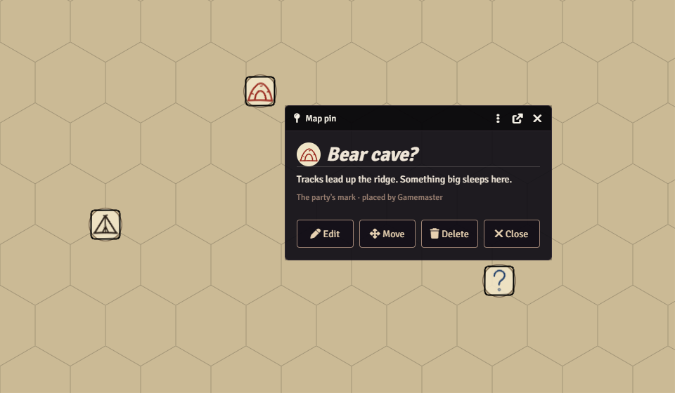

# Places

[Back to the README](../README.md)

Things that belong to a scene: title cards when you arrive, inns to rest at, the party's own map pins, and the scene settings that hold them.

- [Zone title cards](#zone-title-cards)
- [Rested at the inn](#rested-at-the-inn)
- [Map pins](#map-pins)
- [Table Tools tab](#table-tools-tab)

Settings are on the control panel's **Places** tab.

## Zone title cards

**How to use:** open a scene's configuration, find *Title card* on the **Table Tools** tab, give it a title and subtitle, and activate the scene. **Preview title card** (control panel › Places) shows one on your screen only.

With **Zone title cards** on, activating a scene shows its title over the map on every screen viewing it: large gold serif lettering in the upper third, a thin ornament line and an optional subtitle. It fades in, holds (*Seconds on screen*, 4 by default) and fades out, over the canvas without moving anything; with the browser's *reduce motion* preference it appears and disappears without fading.

- **Per scene** (Scene configuration › Table Tools › *Title card*): **Show a title card**, **Title** (blank: the scene's navigation name, or its name if that is empty), **Subtitle**, **Sound** (blank: the default sound, if any). The module bundles no audio: pick your own short clip.
- **When** (*Title cards show*): when a scene is activated (default), or also every time someone's view moves to a scene (a player pulled to another scene, a GM looking around).
- **World load**: the scene that's already active when someone joins shows no card, unless **Show a card when the world loads** is on.
- **Who**: everyone (default) or players only. **Every scene gets a title card** off means only scenes you tick show one.
- **Preview title card** (Places tab) shows the current scene's card on your screen only.

For scripters

`api.zoneTitles.show(scene)` or `api.zoneTitles.show({ title, subtitle, sound })` shows a card on the client running it.

## Rested at the inn

**How to use:** open a scene's configuration, **Table Tools** tab › *Inns* › **Add inn**, or right-click an innkeeper's token and click the mug button (**Make innkeeper here…**). Then rent from that token's bed button, **Rent rooms…** (control panel › Places) or the **Rent Rooms** macro.

**Inns** (since 1.27) are records on their scene, several per scene if you like. Each has a **name** (blank: the scene's name), a **room price** per person per night (like `5s` or `1g 20s`; blank: *Room price per person per night* on the Places tab, 5 silver to start; a plain number is read in *Fares without a coin are in*), an optional **innkeeper** (a token on the scene; its HUD gets a *Rent rooms* button) and, on v14 scenes with regions, an optional **Region** (a long rest counts as at the inn when the character's token is inside it). At most 20 inns per scene. Prices follow your coin system: 5s is 50 copper with standard coins and 500 with three coins.

**Renting rooms** (GM): the innkeeper's HUD button, **Rent rooms…** on the Places tab or the **Rent Rooms** macro. With several inns on a scene you pick one. The dialog lists the party's player characters (the party actor's members, or player-owned characters with a token on the scene) with a tick each, the price per person and the total. Payment comes from the party actor's coin (default) or each character's own (*Rooms are paid from*), smallest coins first with change, as flight fares are. If there isn't enough, nothing is charged and the dialog says who's short. On a scene with no inn you're asked first.

The chosen characters become **Rested**: the GM's client records each rental in the toolkit's hidden GM journal, and the character is marked Rested for display (*zzz* by their name in the character pane, and optionally a *Rested* status icon on their token). Chat says "The party takes rooms at *inn*. Rested."

**The next long rest** of a Rested character gives **Rested gives**: Heroic Inspiration (default; nothing if they already have it), one extra Hit Die back (their largest spent die), or temporary hit points equal to their character level (if more than they have). It's checked against the GM's rental record, not the character's flag, so a player can't make their own character Rested. Then Rested clears and a chat line says what they got. A long rest away from an inn still counts while **Rested lasts until the next long rest anywhere** is on (default); off, Rested is lost with no benefit. A player's own long rest is sent to the GM's client, which applies it; with no GM connected, Rested waits for the next long rest.

**Rest after renting** (feature *Rest after renting rooms*, 1.28): when the rooms are paid, the GM is offered **Long rest everyone**, which runs dnd5e's long rest for each character who rented (no rest dialog, with dnd5e's chat card, so Rested is granted as usual) and, ticked by default, moves world time on once by **Hours the inn rest moves time on** (Places › Advanced, default 8; 0 never). dnd5e's own time advance is turned off for these rests, so time moves once, not per character. Flights still never move time unless *Flights advance world time* is on.

**Players can ask for rooms**: on a scene with an inn a player's Rent Rooms macro whispers the GMs a request with a **Rent rooms…** button. The GM still picks who and confirms.

**Upgrading from 1.26**: a scene marked *Inn* becomes one inn record with the same name and price the first time the GM loads 1.27 (the old setting stays on the scene, unused). Characters already Rested keep it.

For scripters

`api.rentRooms({ scene, inn, actors })` opens Rent rooms. Inns are stored on their scene as `flags.wayfarers-toolkit.inns = { v: 1, list: [{ id, name, price, innkeeper: { actor, token } | null, region | null }] }` (at most 20 per scene). A Rested character carries `flags.wayfarers-toolkit.rested = { scene, inn, at }` for display; the rental itself is in the hidden GM journal. The benefit is applied from dnd5e's `dnd5e.restCompleted` hook. More under `api.inn` in the [scripting guide](scripting.md#public-api-and-hooks-whats-stable).

## Map pins

**How to use:** click the **Map pin** button (the pin icon in the token controls), then click the map. An empty spot opens the new-pin dialog; a pin opens its card. Double-clicking a pin opens its card too. **Esc** cancels.

With **Map pins** on, the party can mark up any scene, the way you'd pencil notes onto a paper map: no glowing markers, just ink on parchment.

**A pin** has a **label** (shown under it on the map), a short **note** (up to 500 characters), a **mark** (pin, flag, camp, cave, question, cross, skull or star: the module's own hand-drawn art), an **ink** (iron-gall black, sepia, red ochre, indigo, verdigris or oak-gall violet) and, with the quest log on, an optional **quest** link. A small parchment disc sits behind each mark so it reads on dark maps (*Parchment behind pins*).

**Who does what**

| | Players | GM |
| --- | --- | --- |
| Party pins | see all of them; place, change, move and delete them (*Players can place map pins*; with *Players can change any party pin* off, only their own) | everything |
| GM pins | see them, unless hidden; can't change them | place, change, move, delete; **Hide** / **Reveal** |

Placing a pin as GM, choose **Whose pin** (the party's or the GM's) and, for a GM pin, **Hidden from players**. A hidden pin is faint on your map, isn't drawn for players at all, and its map note carries no label until you **Reveal** it (from its card).

**Players don't need any permission.** A player's new pin, change, move or delete is sent to the GM's client, which checks it again and saves it. With no GM logged in nothing is saved and the player is told so. Players never touch the map notes directly, so core's *Create map notes* permission doesn't matter.

**The pin card** shows the label, note, who placed it and the linked quest, with an **Open quest** button. A linked quest only shows (and only opens) if that user can see it in the quest log: a player never learns about a hidden or not-yet-given quest from a pin, and can't link one. When the linked quest is completed or failed, the pin fades (*Fade pins of finished quests*, on).

**Seeing pins:** pins are Foundry map notes, so they show on every layer while map notes are switched on (Journal Notes controls › *Toggle notes*), and always while the Journal Notes layer is open. With *Show map notes when a scene has pins* on (default), the toolkit switches that on once in each browser the first time it shows a scene with pins; if someone turns it off again, it stays off. On scenes with levels, a pin is placed on the level being viewed.

**Settings** (control panel › Places › Advanced): *Players can place map pins* (on), *Players can change any party pin* (on), *Fade pins of finished quests* (on), *Pin size* (40 px, 32–96), *Parchment behind pins* (on; reloads), *Show map notes when a scene has pins* (on).

For scripters

**Data:** each pin is a Foundry map note (Note document) on its scene with `flags.wayfarers-toolkit.pin = { v: 1, kind: "party" | "gm", hidden, label, text, icon, ink, quest, by }` (`by`: the user who placed it). Up to 300 pins per scene can come from players. *Remove toolkit data* › *Delete map pins* removes them all.

`api.pins.place()` arms the click; `api.pins.create({ label, text, icon, ink, quest, kind, hidden }, { scene, x, y })`, `update(note, input)`, `move(note, { x, y })`, `remove(note)`, `reveal(note, hidden)` (GM), `open(note)`, `list(scene)` (pins this user can see: `{ id, note, pin }`), `read(note)`; `icons` and `inks` list the choices. Players' calls go through the GM like the tool's.

## Table Tools tab

Per-scene options live in one place: open a scene's configuration and go to the **Table Tools** tab, *Wanderer's Toolkit* section. Other Wanderer's modules add their own sections to the same tab. The toolkit's section shows only the parts whose tools are on:

- **Title card** (Zone title cards): show a card, title, subtitle and sound for this scene. See [Zone title cards](#zone-title-cards).
- **Dungeon** (Vendor Trash): creatures on this scene drop more. See [Dungeon loot](loot-and-coins.md#dungeon-loot).
- **Inns** (Rested at the inn): add, edit and remove this scene's inns. See [Rested at the inn](#rested-at-the-inn).

Title card and Dungeon are saved with the scene configuration window; inns are saved at once with their own buttons. With none of these three tools on, the section isn't added.
