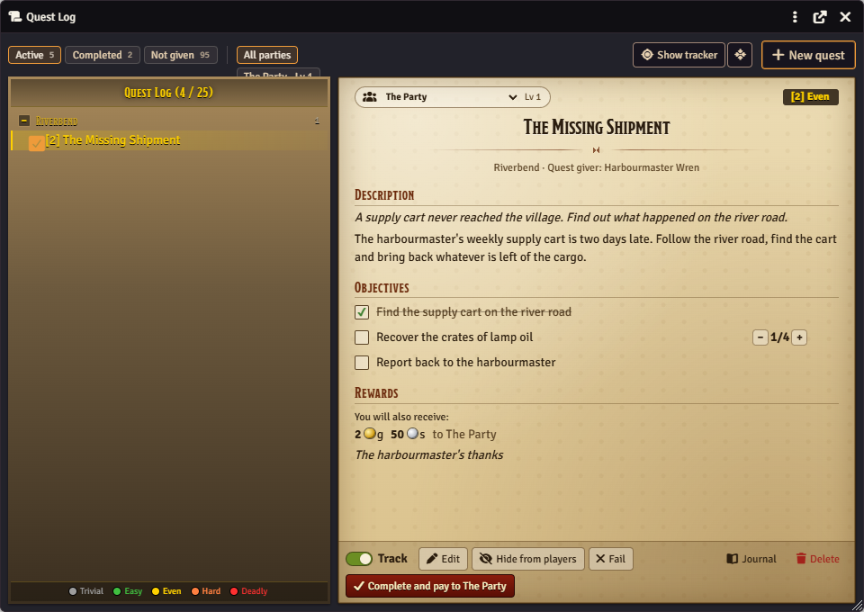
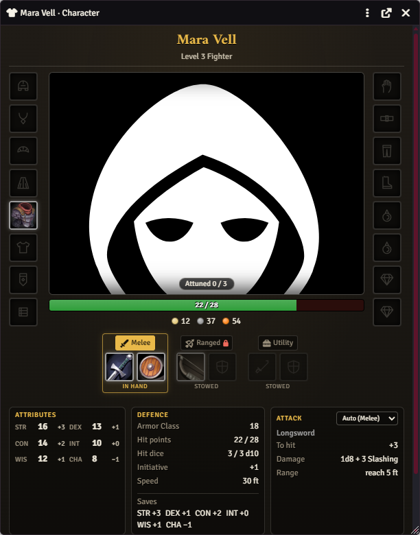
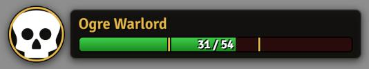

# Quests and characters

[Back to the README](../README.md)

The story side of the table: the quest log and tracker, the character pane, and boss frames in combat.

- [Quest log](#quest-log): [setup](#setup), [making quests](#making-quests-gm), [what players see](#what-players-see) (tracker, map pins, Updated glow), [moments](#moments), [journals](#journals)
- [Character pane](#character-pane): [slots](#slots), [equipping](#equipping), [what fits where](#what-fits-where), [weapon sets](#weapon-sets), [item comparison](#item-comparison), [MMO-style tooltips](#items-with-mmo-style-tooltips)
- [Character sheet replacement](#character-sheet-replacement) (all pages; off by default)
- [Renown](#renown): [factions and tiers](#factions-and-tiers-gm), [awarding renown](#awarding-renown-gm), [the Reputation page](#the-reputation-page), [merchant discounts](#merchant-discounts), [for scripters](#renown-for-scripters)
- [Boss frames](#boss-frames) and [phase marks](#phase-marks)
- [Keyboard shortcuts](#keyboard-shortcuts) and [windows](#windows-and-shortcuts)

Settings are on the control panel's **Quests**, **Character** and **Boss & Combat** tabs.

## Quest log

**How to use:** press **L**, click the scroll button in the token controls, or run the **Quest Log** macro. The GM clicks **New quest**; players only read.

Quests stay narrative: each one has a few objectives written as things to do ("Handle the bandit camp", "Find out who hired them"), and the GM ticks them off when the story says so. An objective can also have a counter ("Wolf pelts 3/8") that the GM moves with + and −; it ticks itself when the count is reached.

Since 1.29 each quest belongs to **one party** (a group actor). Players see a quest only if they own a character in its party: in the log, the tracker, the journal, chat cards and on map pins. A quest with no party is GM-only until you pick one. The log looks like a native Foundry window in both the dark and the light theme; the quest list (a stone frame) and the quest page (parchment) look the same in either.

### Setup

1. Make sure **Quest log** (and, if you want it, **Quest tracker**) is switched on in the control panel's Features tab.
2. Run setup to add a **Quest Log** macro (shared with players). Everyone can also open the log with the scroll button in the token controls or the **L** key (change it under **Configure Controls**).
3. **Parties** (control panel › Quests): tick the group actors quests can be given to. None ticked: the party actor (General tab). **Quest cap** (Advanced, default 25): how many active quests one party can have before you're warned; giving more still works. The list's header shows *Quest Log (n / cap)*.
4. Optional settings (control panel › Quests): **Quest folder** (the journal folder quests live in, default *Quest Log*), **Announce objectives in chat**, and **Sound when a quest is given** / **Sound when a quest is completed** with a **Quest sound volume** (blank by default; pick your own audio files).



### Making quests (GM)

Click **New quest** in the log. A quest has:

- **Title**, **Zone / region** (quests are grouped under zone headers) and an optional **Level**. A number (`4`, or `Lv 4`) gives the quest a difficulty against its party: quest level minus the party's level (the average character level of its members) is **Trivial** (−5 or lower, grey), **Easy** (−4 to −2, green), **Even** (−1 to +1, yellow), **Hard** (+2 or +3, orange) or **Deadly** (+4 or more, red). Text that isn't a number (`3-5`, `Heroic`) is shown as it is, without a colour.
- **Party**: the group actor the quest belongs to (new quests get the log's party filter, or the first party).
- **Quest giver**: type a name or drop an actor on the field to link it.
- **Summary** (a line or two, used in chat) and a rich-text **Description**.
- **Objectives**: add, remove and reorder rows. Each can be **Hidden** (players don't see it until you reveal it) or **Optional**, and can have a count (blank for none).
- **Rewards**: coin written like `1g 20s` or `50c` (a plain number is read in *Fares without a coin are in*, control panel › Travel; works with either coin system), **Items** dropped from the sidebar or a compendium (always given), **Choose one of** (items a party member picks from; the GM can change the pick), **Renown** rows when [Renown](#renown) is on (a faction and an amount such as `+2` or `-1`; each character in the party gains or loses it when the rewards are paid), and free text. Item slots are bordered by rarity: mundane grey, common white, uncommon green, rare blue, very rare purple, legendary orange.
- **Status**: *Not given*, *Active*, *Completed* or *Failed*, and **Hidden from players**.

In the log the GM sees every quest, including ones not given yet (*Not given* tab) and hidden ones (marked with a crossed-out eye), and filters by party with the chips at the top (**All parties**, or one party with its level). The list groups quests by zone (click a zone to fold it; remembered on this computer), each row with its Track box, `[level]` and name coloured by difficulty, *(Ready)* when every required objective is done, and the party's name when several parties are shown. The page shows the party badge (a drop-down for the GM: changing it moves the quest to another party) and the difficulty, the title, zone and giver, the description, objectives (with n/m counters), and the rewards: *You will receive*, *Choose one of these rewards* and *You will also receive* (the coin, "to" the party). Buttons: **Track**, **Edit**, **Hide from players**, **Give quest**, **Fail**, **Reopen**, **Journal**, **Delete** and **Complete and pay to *party*** (completes, then pays; with a reward still to choose it completes and leaves **Pay rewards** for later). Click an objective's box to tick it; **Reveal** shows a hidden objective.

### What players see

Players only read, with one exception: a member of the quest's party picks the reward under *Choose one of these rewards* (the choice goes to the GM's client, which checks they're in the party). They see their party's quests that have been given and aren't hidden, under **Active** and **Completed** (failed quests sit in Completed, struck through), with visible objectives (counters as n/m), the description and rewards. There's no party filter for players. The journal entries follow the same rule: a player gets Observer on a quest's journal only once it is given, not hidden, and they own a character in its party (it's updated when a party's members change). Chat cards for a quest are whispered to the GMs and those players.

**Tracker.** Newly given quests are tracked automatically (up to five); untick **Track** in the log to drop one. The tracker lists each tracked quest of the player's party, its title coloured by difficulty, and its open objectives with counters (n/m). It starts at the top right, left of the sidebar, in the first spot that covers none of Foundry's own interface (scene controls and navigation, players list, hotbar, camera dock). **Drag it by its title** to put it anywhere (mouse or touch), or focus its grip (Tab) and use the **arrow keys** (Shift for bigger steps); it's kept inside the window, and each person's spot is remembered on their own computer. Double-click the title, press **Home** on the grip, or use the reset button next to **Show tracker** in the quest log (or *control panel › Quests › Reset quest tracker position*) to put it back. Collapse it with its arrow; close it with its **X** and bring it back with **Show tracker** at the top of the quest log (the same as **Show the quest tracker on my screen**, Quests tab). Tracking a quest while it's closed doesn't reopen it.

**Objective → map pin** (feature *Quest objectives find their map pin*, 1.28). Link a map pin to a quest from the pin's card. Then clicking one of the quest's open objectives in the tracker, or an objective or the quest's title in the quest log, moves the map to the pin and pings it (Foundry's own ping, seen by everyone on the scene; a GM's hidden pin is moved to but never pinged). Clicking the quest's title in the tracker opens the log and also moves to the pin and pings it (without a notice when the quest has no pin). A pin on another scene: the GM is asked whether to view that scene (only the GM moves); a player is told which scene it's on. With several pins, one on the scene you're viewing wins.

**Updated** (feature *Updated quests glow*, 1.28). When the GM changes a quest a player can see (status, an objective ticked or revealed, its text), it pulses with an *Updated* tag in that player's tracker and quest log until they open it in the log. Only what the player sees counts (a change to hidden objectives or GM text doesn't glow). Each computer remembers what it has seen; the first load after updating marks everything as seen. GMs never see the glow.

### Moments

- **Give quest** posts a *New quest* card with the summary (and plays the accepted sound).
- Ticking or revealing an objective posts a short line (or a notification, with *Quest objectives in chat* off).
- **Complete** posts a *Quest complete* card listing the rewards, with a **Pay rewards** button for the GM: the coin goes into the purse of the quest's party actor and the items (fixed ones plus the chosen one) onto it, logged in the coin log as *Quest reward: …*. Each quest pays once; it waits while a reward is still to be chosen.
- **Fail** posts a *Quest failed* card.

Hidden quests announce nothing; showing an active quest to players announces it then.

### Journals

Each quest is a journal entry with one text page in the quest folder. The page is rewritten from the quest's data whenever it changes, so it reads well on its own and in exports: status, level, zone, party, giver, summary, objectives (☑/☐, counters), description and rewards. Hidden objectives and secret text never go on the page (the full quest is kept in the toolkit's hidden GM journal). Edit quests in the quest log rather than on the page, since the page is regenerated.

**Upgrading to 1.29.** Once, on the GM's client, every existing quest is given the party actor (General › Party actor) as its party, levels like `Lv 4` become numbers (anything else is kept as text), reward items get their rarity, and each journal's ownership is set from its party. Until then old quests keep the old rule (every player sees given quests). Without a party actor the quests become GM-only until you choose a party for each (the health check lists them).


<details><summary>For scripters</summary>

`game.modules.get("wayfarers-toolkit").api.quests` (also usable from Monk's Active Tiles script actions):

```js
const q = game.modules.get("wayfarers-toolkit").api.quests;
await q.create({ title: "Trouble at the Old Mill", zone: "Riverside", summary: "Bandits hold the mill.",
  objectives: ["Deal with the bandit camp", { text: "Find out who hired them", hidden: true }],
  rewards: { coin: "1g 20s", items: ["Compendium.dnd5e.items.Item.…"], other: "Goodwill of the miller" } });
await q.activate("Trouble at the Old Mill");          // give it
await q.tickObjective("Trouble at the Old Mill", "bandit camp");  // by index, id or (part of) the text
await q.revealObjective("Trouble at the Old Mill", 1);
await q.complete("Trouble at the Old Mill");          // or q.fail(…), q.reset(…)
q.open("Trouble at the Old Mill");
```

Also `update(quest, patch)`, `hide(quest, true|false)`, `untickObjective`, `payRewards`, `delete`, `list()`, `get(quest)`, `track(quest, on)`, `showTracker(on)` and `resetTrackerPosition()` (the on-screen tracker on this client; experimental). From 1.29 (experimental): `progressObjective(quest, objective, delta)` (counter +/−), `assign(quest, partyId)` (`""` = no party), `pickReward(quest, itemUuid)` (players: sent to the GM), `parties()` (`[{ id, name, level }]`) and `difficulty(quest)` (`{ id, label, colour }` or null). `create` takes `party` (a group actor id), `level` (number or text), objectives with `target`, and `rewards.choice`. Quests are found by journal id, UUID or name. All of these that change a quest are GM only: on a player's client they just warn, and no quest change is ever sent over the socket. Monk's Active Tiles runs its actions on the GM's client, so tiles work as usual.

The tracker on this client: `api.quests.showTracker(on)` and `api.quests.resetTrackerPosition()`. The players' view of a quest is in `flags.wayfarers-toolkit.quest` (record version `v: 2` since 1.29: `party`, numeric `level` with `levelText` for other text, objective `target` / `progress`, rewards `choice` / `pick`). The Updated glow's record is the hidden client setting `questSeen`. Hooks fired when quests change: see the [scripting guide](scripting.md#hooks).

</details>

## Character pane

**How to use:** click the shirt button in a dnd5e character sheet's header, then drag items from the sheet onto the slots.

A character sheet in the style of a classic MMO character screen (1.30). The title shows the name, *Level N Class · Species · Party* and a **Rested** badge (its tooltip names the inn and the benefit). The portrait sits in the middle with **Attuned n / 3** on it, a **health bar** (temporary hit points as a striped segment) and the character's **coins** under it, and the gear slots run around it. Below the doll are three boxes:

- **Attributes**: the six ability scores and their modifiers.
- **Defence**: Armor Class, hit points, hit dice, initiative, speed and the six saving throws (proficient ones highlighted).
- **Attack**: follows the [weapon set](#weapon-sets) in hand. The Melee set shows the main-hand weapon, the Ranged set the ranged weapon, the Utility set the spell attack and save DC for a caster; a caster holding only a focus shows the spell. Each shows to hit, damage and range (or spell attack, save DC and ability). Pick *Melee*, *Ranged* or *Spell* from the box's menu to look at another; *Auto* goes back to following the set (the choice lasts while the window is open).

The sheet is an in-world panel: it stays dark in both Foundry themes, while the window around it follows your theme.

**Open it** with the shirt button in the header of a dnd5e character (or NPC) sheet, also in the sheet's **⋮** controls menu. Anyone who owns the actor can open it, so players can dress their own characters. Turn it off under control panel › Features.

The window is resizable: the slots and portrait grow with it, the *Equippable items* list scrolls inside it, and each player's size and position are remembered on their own computer.



### Slots

Classic-MMO equipment slots, without an Ammo slot:

| Left | Right | Bottom |
| --- | --- | --- |
| Head, Neck, Shoulder, Back, Chest, Shirt, Tabard, Wrist | Hands, Waist, Legs, Feet, Finger ×2, Trinket ×2 | The three [weapon sets](#weapon-sets) and the Relic slot (Main Hand, Off Hand and Ranged with weapon sets off) |

Empty slots show a faint outline of what goes there (a helm, a pendant, a cloak, boots, a ring…). Item icons get a border and a soft glow in their quality colour (grey, white, green, blue, purple, orange, gold; the shared colours of the Wanderer's modules): an item with an MMO-style tooltip uses its own colour; otherwise dnd5e rarity decides (none / mundane grey, common white, uncommon green, rare blue, very rare purple, legendary orange, artifact gold). Hover an item for its tooltip.

### Equipping

- **Drag** an item from the character sheet's inventory, from the pane's *Equippable items* list, from a compendium, the Items sidebar or another actor onto a slot. Items from elsewhere are copied onto the character first, the same way dropping them on the sheet would.
- **Click a slot** to pick from the character's items that fit it, or to take off what's there.
- **Click an item** in the list to put it in its slot (the first free one it fits, else replacing what's there). If it could go anywhere, the pane asks where.
- **Take an item off** by right-clicking its slot, dragging it back to the list, or choosing *Take off*.
- Dragging between the two finger (or trinket) slots swaps them.

Slotting an item marks it **equipped** on the dnd5e sheet; taking it off unequips it. Unequipping an item on the sheet takes it out of its slot too. Items that are equipped but not in a slot are marked with an *E* in the list, and **Slot equipped items** puts them into free slots.

### What fits where

| Item | Slots |
| --- | --- |
| Melee weapon | Main Hand or Off Hand. Thrown weapons can also go in Ranged. |
| Two-handed weapon | Main Hand only. It fills the Off Hand (shown greyed out) and takes off whatever was there. |
| Ranged weapon | Ranged |
| Shield | Off Hand |
| Light, medium, heavy or natural armour | Chest |
| Clothing | Chest, Shirt or Tabard (or the slot its name suggests: "boots", "gloves"…) |
| Ring | Finger |
| Wand, rod | Ranged or Off Hand |
| Trinket | Trinket, or any other gear slot |
| Wondrous and other equipment | Any gear slot (not the weapon slots). Its name suggests a default: a cloak goes on the Back, boots on the Feet, an amulet on the Neck; with no hint, the pane asks. |

One item per slot. The pane warns, but doesn't stop you, when an item needs attunement and the character is already attuned to the maximum (3), when a second suit of armour goes on, or when a second shield does.

### Weapon sets

You can't hold a sword, a shield and a longbow all at once, so the weapon slots come in three sets, and only one is in hand:

| Set | Hands | For |
| --- | --- | --- |
| **Melee** | Main hand, Off hand | A melee weapon with a shield, a second weapon, or nothing (a versatile weapon in both hands) |
| **Ranged** | Ranged, Off hand | A bow, crossbow, sling, thrown weapon, wand or rod. A one-handed ranged weapon may pair with an off-hand item |
| **Utility** | Main hand, Off hand | A weapon with a torch, a lantern, an instrument or a held holy symbol, or two held things |

**Only the set in hand is equipped** on the dnd5e sheet, so only its weapons count for attacks, AC and bonuses (and for the pane's stats). The other two sets stay visible, dimmed and marked *Stowed*. **Click a set's tab** to swap: the pane equips that set's items and unequips the others' on the sheet. Drag items onto any set's hands, click a hand to pick what goes there, right-click one to take it out of the set. Clicking an item in the list puts a weapon in a free hand of the set in hand (a ranged weapon in the Ranged set, a torch or lantern in Utility). A tooltip on a stowed item says it's stowed.

**Hands.** A two-handed weapon empties its set's off hand. Shields are worn: one that's equipped stays on through a swap (the pane shows it still lit in its set), so:

- A set that needs the shield's hand (a two-handed weapon, an off-hand item, or a ranged weapon that loads ammunition) can't be made active while the shield is on. The pane says why ("Stow the shield first") with a **Stow shield** button, which unequips the shield. That's a separate, deliberate step; the swap never takes a shield off by itself. Swap back to the shield's set and it goes back on.
- **Bucklers** are strapped to the arm and leave the hand free: a buckler stays on with a one-handed ranged weapon, or with a one-handed weapon in each hand. Two-handed weapons are still blocked. A shield counts as a buckler when *buckler* is in its name, or when a GM ticks **Buckler** at the top of its item sheet (untick it to say it isn't one).
- **Versatile weapons** with the off hand empty (and no shield on) are shown as held in both hands, with the two-handed damage. dnd5e does the damage maths.
- **Thrown weapons** can sit in the Melee or the Ranged set.
- A **Ranged set with no ammunition** carried gets a warning; it isn't blocked.

**Swap cost in combat.** The GM picks the cost in **Weapon swap cost** (control panel › Character): Free, Part of an attack (the default: under the 2024 rules you can equip or unequip one weapon as part of each attack), Object interaction, Bonus action or Action. When a character who's a combatant in a started combat swaps, a short public chat line says so, for example *Mira swaps to Ranged (part of an attack).* Nothing is enforced or spent. **Stow shield** in combat posts a line too, noting that taking a shield off (or putting one on) takes the Utilize action. Outside combat, swaps are free and silent.

**Relic slot.** Characters of the classes ticked in **Classes with a relic slot** (dnd5e class identifiers; Paladin, Druid and Cleric to start with) get a Relic slot beside the sets. It's worn, needs no hand and is never part of a set. It takes a spellcasting focus (an item with the Spellcasting Focus property, or a holy symbol, arcane focus or druidic focus) or a relic: an item with *libram*, *idol*, *totem*, *relic* or *sigil* in its name, or one a GM ticks **Relic** on in its item sheet (unticking it says it isn't one). Slotting it equips it on the sheet.

**Existing characters.** The first time a character's pane opens with weapon sets on, what was in the Main Hand and Off Hand becomes the Melee set, what was in Ranged becomes the Ranged set, and Melee is in hand (so a ranged weapon that was equipped is now stowed and unequipped). The set in hand is still recorded in the old slots, so switching **Weapon sets** off (control panel › Character) gives back the single Main Hand, Off Hand and Ranged slots with that set in them, all equipped at once, as before.

**Changing things on the sheet.** Equipping a stowed set's item, or unequipping a weapon in hand, on the dnd5e sheet (or from a macro) takes that item out of its set, so the pane never disagrees with the sheet.

<details><summary>For scripters</summary>

`game.modules.get("wayfarers-toolkit").api.characterPane(actor)` opens the pane (no actor: the selected token's, else your own character). Weapon sets: `api.pane.activateSet(actor, "melee" | "ranged" | "utility")`, `api.pane.assignWeapon(actor, item, set, "main" | "off")`, `api.pane.unassignWeapon(item)`, `api.pane.stowShield(actor, shieldId)` and `api.pane.weaponState(actor)`. Slots: `api.pane.slotItem(actor, item, slot)` / `unslotItem(item)` (slot names in the [scripting guide](scripting.md#macros-and-scripting)). Data: an item's slot is `flags.wayfarers-toolkit.slot`; the sets are `flags.wayfarers-toolkit.weaponSets` on the actor.

</details>

### Item comparison

Hover an item in the pane's *Equippable items* list and its tooltip ends with a comparison against what you'd be swapping out: the item in the slot it would go in, or, for a weapon, shield or held item with weapon sets on, the matching hand of the matching set (a bow against the Ranged set's ranged weapon, a sword against the Melee set's main hand, a shield against the off hand, a torch against the Utility set's off hand). Each line shows the hovered item's value and, greyed, the current one's:

- **Armor Class** (armour and shields, magic bonus included), **Damage** (dice and damage type, with the average roll), **Attack bonus**, **Magic bonus**
- **Properties** gained (+) and lost (−), **Attunement** (needing it counts as worse, since it takes one of your three slots), **Value** and **Weight** (lighter is better)

Green is better, red is worse, white is just different. Lines where both are the same are left out. An empty slot says so. A note follows the [hands rules](#weapon-sets): *Needs both hands: Kite Shield would have to be stowed*, *… Dagger would come out of the off hand*, or *Needs a free hand to load* for a crossbow with a shield (a buckler is fine).

The same comparison shows when you hover an item in an Item Piles loot pile, body or merchant window, against your own character (your assigned character, else the selected token's). Items already in a slot or set aren't compared. Switch it off with **Item comparison tooltips** (control panel › Character).

### Items with MMO-style tooltips

Items whose description holds an MMO-style item tooltip, like those in the optional classic MMO item compendium, are placed by the tooltip's slot line: Head, Neck, Shoulder, Back, Chest, Shirt, Tabard, Wrist, Hands, Waist, Legs, Feet, Finger, Trinket, Main Hand, One-Hand (either hand), Two-Hand, Off Hand / Held In Off-hand, and Ranged / Thrown / Relic in the Ranged slot. Their border uses the tooltip's quality colour, and hovering shows that tooltip. When a description has no slot line, the compendium folder the item came from decides (Head, Two-Hand, Finger, Wands…). Nothing from that module is bundled; icons come from the items.

**Armour pieces and AC.** MMO-style helms, shoulders, gloves, boots and the like are often typed as light, medium or heavy armour with no AC of their own, and dnd5e only counts one piece of armour for AC. So that a helm doesn't replace the chest armour, armour-typed items worn in a slot other than **Chest** are left out of dnd5e's AC calculation while the character pane is on. Armour in the Chest slot, and equipped armour that isn't in any slot, counts as usual.


## Character sheet replacement

**In progress, off by default.** Turn on *Character sheet replacement* (control panel › Features; reloads) and player characters open in the toolkit's own sheet, **Wanderer's Toolkit sheet**, in place of the dnd5e character sheet. The sheet is dark in both Foundry themes; only Foundry's window frame follows the theme. Turn the feature off and the dnd5e sheet is back; nothing in your world changes either way. A single actor can still be switched to another sheet in its *Sheet* configuration, and a GM's choice under *Configure Default Sheets* wins over the toolkit.

The rules stay dnd5e's: every value is dnd5e's own prepared value (armour, items and effects included), and every button calls dnd5e.

- **Title band**: level, name, class · species · background, XP bar (hidden when dnd5e's levelling mode is *no XP*), **Rested** (with *Rested at the inn*), Heroic inspiration, Short rest and Long rest (dnd5e's rest dialogs; hidden from players when dnd5e's *Allow rests* is off), and **Play / Edit**. In Edit mode an orange badge counts dnd5e's sheet warnings (hover for the list).
- **Vitals**: Armor Class, hit points with temporary hit points, hit dice, **Initiative** (click: dnd5e's initiative roll), speed, proficiency bonus, exhaustion (click a pip to set the level, the lit top pip to lower it) and death saves (click: dnd5e's death saving throw).
- **Bookmarks** on the right edge (since 1.33.1): Character, Details, Inventory, Features, Spells, Effects, Biography, Bastion (only when dnd5e's bastions are on and the character qualifies) and Special traits. Every page is described below. Every page has a small *Open in system sheet* link at the bottom.
- **Play / Edit**: Play is for rolling and using; Edit shows the inputs and the gear buttons that open dnd5e's own settings windows.
- **Conditions** along the bottom.
- **No favourites**: the sheet has no favourites bar, so the *Favorite* / *Remove Favorite* entries are left out of the item, effect and activity menus here (2.3.1). Favourites set on dnd5e's sheet are kept and still show there.
- **GMs** get a **System sheet** button in the window header that opens the dnd5e sheet for the same actor.
- **Key C** (with *Keyboard shortcuts* on): opens your own character's sheet (with none assigned: the character you own, or with several, the one whose token is selected); a GM opens the selected token's character (or gets a note to select one). Press again to close. It never fires while you type in a field. Foundry's own C (*Toggle Character Sheet*) moves to **Alt+C** on each computer the first time the world loads with the sheet on, but only if nobody changed that key and nothing else uses Alt+C there (the health check says what happened). (1.33.0 aimed for Shift+C, but Foundry v14 already uses Shift+C for *Focus Chat*, so it never moved there; 1.33.1 moves it to Alt+C instead.) Turn the sheet or *Keyboard shortcuts* off and Foundry's key goes back to C, unless you have set your own key for it since. Rebind *Open character sheet* in Configure Controls if you prefer another key.

Other modules can add their own pages to the sheet (2.3, for module authors: [Sheet pages for other modules](scripting.md#sheet-pages-for-other-modules)); their bookmarks sit among ours.

### Character page

The **paper doll** is the [character pane](#character-pane)'s, on the same data: anything you slot here shows in the pane and the other way round. The gear slots run down both sides of the portrait (Head, Neck, Shoulder, Back, Chest, Shirt, Tabard, Wrist on the left; Hands, Waist, Legs, Feet, two Fingers and two Trinkets on the right). Each filled slot has its item's quality colour on the border; hover for the item's tooltip and comparison. The portrait shows **Attuned n / max** (click the picture to view it full size). Below it are the **weapon sets** (Melee, Ranged, Utility) with the set in hand lit and the others stowed, plus the **Relic** slot for the classes that use it (the pane's setting). Click a set's tab to swap to it.

- **Drag** an item onto a slot or a hand to equip it there; drop it on the portrait to put it in its best place. Drag a slotted item onto *Equippable items* (or right-click the slot) to take it off. Click a slot to pick what goes there.
- **Attributes**: each ability's name, score and modifier in three columns; click a name to roll dnd5e's ability check. In Edit mode the scores become inputs (`+2`, `-1` and `=15` work as on dnd5e's sheet).
- **Defence** (AC, hit points, hit dice, initiative, speed, saves) and **Attack**, which follows the weapon set in hand (Melee, Ranged, or Spell for a caster's Utility set; pick another view in its menu). **Use** rolls the weapon through dnd5e.
- **Equippable items**: everything that could be worn or held but isn't in a slot; items marked *E* are equipped without a slot. The note *n equipped but not in a slot* has a **Slot equipped items** button.
- Edit mode: **Change portrait** (or the token art) and **Show token instead of portrait** (dnd5e's own setting).

### Details page

- Six **ability** medallions: modifier (large), score, and the saving throw in the corner (gold when proficient). Click the medallion for dnd5e's ability check, the corner for the saving throw. While concentrating, a **Concentration** button rolls dnd5e's concentration save.
- **Skills**: proficiency mark (empty, half, full, expertise), ability, total and passive score; click a skill to roll it. **Tools** the same way.
- **Origin** (species and background, click to open them; creature type; size) and **Traits** (senses, resistances, immunities, vulnerabilities, damage modification, armour and weapon proficiencies, languages), exactly as dnd5e lists them.
- Edit mode: click a proficiency mark to cycle it (dnd5e's own control), change a skill's ability, scores and size, and use the gear buttons to open dnd5e's configuration windows for abilities, skills, tools, senses, damage traits, armour, weapons, languages and the creature type.

### Inventory page

- **Encumbrance** bar from dnd5e (with its encumbered and heavily encumbered marks), the **coins** (edit them in place, or **Manage coin** for dnd5e's currency manager; with the three-coin economy the purse also shows as gold, silver and copper), your **containers** (drop items on one to put them inside) and the attunement count.
- The item list uses dnd5e's sections (Weapons, Equipment, Consumables, Tools, Loot…). Each row shows the item's quality colour, name and type, its **doll slot**, price, weight, quantity (with − / +), uses, **equip** and **attune** buttons, a description toggle and **⋮** for dnd5e's item menu (view, edit, duplicate, delete, split stack, display card…). Click a name to use the item (or view it). In Edit mode rows get edit and delete buttons and there is a **Create item** button.
- **Equipping here also puts the item in its slot on the paper doll** (the pane's rules: its best free slot, a free hand of a weapon set, or the relic slot). An item with no clear slot is equipped without one and shows on the Character page as *equipped but not in a slot*. Unequipping takes it out of its slot.
- **Search** and the **Action / Bonus / Reaction / Equipped / Magical** filters work like dnd5e's; **Sort** switches between your manual order and A–Z.
- Drag and drop works as on dnd5e's sheet: drop items from a compendium, the sidebar or another actor to add them, drag rows to reorder them, drop them on a container to put them inside.

### Features page

- **Classes**: each class with its level, subclass and hit die (click an icon to open it). When dnd5e says a subclass is due, **+ Add subclass** opens dnd5e's compendium browser on that class's subclasses. In Edit mode: change a class's level (dnd5e's own level change, with its advancement steps), delete a class or subclass (dnd5e's dialog), and **+ Add class**.
- The features themselves in dnd5e's groups: one section per class (subclass features with their class), species, background and other features; the **Group** button switches to dnd5e's Active / Passive grouping. Each row shows uses (edit them in place), recovery (*SR*, *LR*…), a recharge button when one is due, the description toggle and **⋮** for dnd5e's item menu. Click a name to use the feature.
- **Search** and the **Action / Bonus / Reaction / Short rest / Long rest / Concentration / Magical** filters, **Sort** manual / A–Z. Edit mode: edit and delete buttons on rows and **+ Create feature**.
- Drop features, classes, species or backgrounds from a compendium: dnd5e's advancement runs as on its own sheet.

### Spells page

- A card per **spellcasting class**: its ability modifier, spell attack, save DC and prepared spells (*n / max*, red when over). The small circle picks the character's main spellcasting ability (dnd5e's setting).
- Spells in dnd5e's sections: cantrips, each spell level, pact magic, and at-will, innate and ritual spells and spells cast from items. Slot sections show **slot pips**: click a lit pip to spend that slot, an empty one to get slots back (dnd5e's rule); pact slots are purple. In Edit mode a gear button opens dnd5e's spell slot settings instead.
- Each spell shows its source and components, casting time, range, target, attack bonus or save, **C** (concentration) and **R** (ritual) tags, and dnd5e's **prepare** button (the star means always prepared). Click a name to cast it.
- **Search** and the **Action / Bonus / Reaction / Concentration / Ritual / Prepared** filters, plus one per spellcasting class and per school; **Sort** A–Z / priority / manual. Edit mode: edit and delete buttons and **+ Create spell**.
- Drop spells from a compendium onto a section to learn them with that section's casting method (dnd5e's rule).

### Effects page

- **Conditions**: every dnd5e condition as a button; click to add or remove it. Exhaustion shows its level: click to raise it, right-click to lower it.
- **Effects** in dnd5e's groups: temporary, passive, inactive, and (when there are any) unavailable effects (from items that aren't equipped or attuned) and enchantments. Each row shows the duration, where the effect comes from (click to open it), a switch to turn it on or off, the description toggle (it also lists the effect's changes) and **⋮** for dnd5e's effect menu (edit, duplicate, delete, break concentration). Concentration is ended from the menu, not the switch.
- **Search**; in Edit mode rows get edit and delete buttons and there is **+ Create effect**.

### Biography page

- **Characteristics** (alignment, eyes, height, faith, hair, weight, gender, skin, age), **Ideals**, **Bonds**, **Flaws**, **Personality traits** and **Appearance**, then the **Biography**. In Edit mode they become fields, and the biography opens Foundry's text editor (save it with the editor's save button).

### Bastion page

Only shown when dnd5e's bastions are on and the character qualifies. The bastion's name, its **defenders**, the **basic** and **special facilities** (with dnd5e's count of how many you may have at this level) and the description. Each facility shows its size or build state, the order in progress with a bar, a crafted item and its hirelings, defenders and creatures. Click a facility's name to give it an order (dnd5e's order window); the small × removes an occupant or cancels a pending trade. Empty slots let you add a facility from dnd5e's compendium browser. Drop an actor onto a facility's occupants to add them, as on dnd5e's sheet.

### Special traits page

The character's **original class** and dnd5e's special traits and global bonuses (feats such as Diamond Soul, species traits, critical hit ranges, bonuses to attacks, checks and saves). They can be read in Play mode and changed in Edit mode.

### Level up

In Edit mode the **level badge** in the title band has a **+**: click it to level up. With one class this starts dnd5e's level-up (its advancement windows: hit points, features, choices). With several classes you pick which class levels up, or **Add a class** (dnd5e's compendium browser). The level selects on the Features page do the same.

## Renown

Turn on **Renown (reputation)** on the Features tab (on by default; it shows nothing until you add a faction). Renown is kept **per character, per faction**: there is no party score. You define the factions in your own world; the toolkit only keeps the numbers, tiers and labels.

A character's **total** with a faction is their score plus any **other sources** (labels the GM adds by hand, such as *Bastion in their land +1*). It never goes below 0. **Tiers** are thresholds on the total; below the first tier a character has no tier. Nothing happens between factions on its own (no opposed pairs), and a parent side keeps no score of its own.

### Factions and tiers (GM)

Control panel › **Character** › **Factions and renown…** (or `api.renown.setup()`).

- **Tiers and presets**: the shared tier set. Each tier has a colour, a name, where it starts (*From*), a merchant **discount %**, the rarity it unlocks, a perk and a title, all your own text. The defaults are four tiers at 3, 10, 25 and 50 (Known, Trusted, Esteemed, Celebrated) with 0, 10, 15 and 25 % off; rename them, change any number and write the perks your world uses. Up to 8 tiers. The **award presets** are the gain buttons (default +1, +2, +3) and the loss dice (default 1d8, 2d6, 2d12), and the **starting faction bonus** steps (default +1 / +2 / +3 / +5, one per tier). **Reset to defaults** puts all of these back (factions, their own tiers and characters' renown stay).
- **A faction**: name, a short note, a **parent side** (subfactions are grouped under it on the sheet) or a **group** (for factions without one, e.g. *Neutral factions*), **Hidden from players**, **Inactive** (folded away on the sheet) and **Starting faction bonus** (recorded only: new tiers here raising the parent side's starting faction by the steps set under *Tiers and presets* is not applied automatically). Its tiers are the shared set or **custom for this faction**. **Merchants** (with *Renown merchant discounts* on): the Item Piles merchants that belong to it (see [merchant discounts](#merchant-discounts)). **Other sources** lists the labels characters have with it.
- **Hidden factions** never reach players: the faction and every character's renown with it are kept in the GM-only records journal, not in the world setting or on the characters. Switching *Hidden from players* off moves them onto the characters (and back again when you switch it on), and the quests that name the faction as a reward are rewritten for players (renaming or deleting a faction does the same). Chat cards already posted stay as they were. Players can't track a hidden faction. A merchant linked to a hidden faction still gets per-character prices in Item Piles' data, which players' clients receive. Visible renown is on the character, so like any field on an actor its owner could change it from the console.
- **Delete** removes the faction and every character's renown with it.

### Awarding renown (GM)

Control panel › Character › **Award renown…**, the **Award** button on a Reputation page (or the ± on a row), or `api.renown.award(...)`. Pick the **whole party** (the party actor's members, or every player character) or **some characters**, the faction, then a **gain** (the preset buttons, or type any amount such as `+4` or `-2`) or a **loss** (a preset die, or a custom formula). Each character changes on their own score: a loss formula is rolled for each character. A line under the form previews the result (*Maren 8 → 10 (Trusted)*).

The **chat card** (*+2 renown · Faction*, each character's new total, and *is now Trusted (10): perk · 10% off* when a tier is reached) is whispered to the GMs and the characters' owners; for a hidden faction to the GMs only.

**Quest rewards**: in the quest editor, **Add renown** adds a row (faction and amount). When the quest's rewards are paid, each member character of its party gets it, with the same card. With Renown turned off, a quest with renown rewards isn't paid at all (a notice says so) until you turn it back on or remove the rows; a quest whose only rewards are renown shows no Pay button then. Rewards with a hidden faction aren't shown to players in the quest log, its journal page or its card.

### The Reputation page

On the [toolkit character sheet](#character-sheet-replacement) the **Reputation** bookmark (after Biography). With the toolkit sheet off, dnd5e's character sheet gets a **Reputation** button in its header menu that opens the same page in a window.

- The **tracked** faction (the star on a row; the character's owner or the GM chooses) is pinned at the top: tier, the bar to the next tier (*12 / 25 to Esteemed*), what the current tier gives and what the next one unlocks.
- Factions are grouped by parent side and group (click a group to fold it), with **search**, **All / Subfactions / Neutral**, **Show inactive** and **Sort: renown / name**. Each row has the tier, the bar, the discount and the other sources.
- The character's owner sees their own; players who can only view the character see it read-only; the GM also gets **Award**, a **±** and **+** (add another source) on each row, a × to remove a source, and in Edit mode a field for the score itself.

### Merchant discounts

Merchant discounts are **optional**: turn on **Renown merchant discounts** on the Features tab (off by default; needs Renown and Item Piles). While it's off, a tier's discount is shown greyed as *10% (discounts off)*, information only, and no Item Piles price is changed; turning it off puts back any prices the toolkit had set at the next load (the acting GM's client), and the health check lists any still in place.

With the switch on, each tier's discount applies at the faction's merchants. With **Item Piles** active, the toolkit sets each character's own buy price at the merchants you linked to the faction (Item Piles' per-character price modifier, through its API): 10 % off is a buy price of 0.9 for that character, selling prices don't change. It updates at once after an award (2.2.1), a moment later (under a second, batched) after other changes (score, source, faction saved), and when the world loads; until then the health check may show "1 price to update". The toolkit only ever changes the per-character prices it set itself: if a merchant already has your own price for a character, that one is kept and the health check says so. Without Item Piles the discount is shown on the sheet only. The discount covers every item at that merchant (the rarity text is for you and your players to read).

**Remove toolkit data** › *Put back the Item Piles merchant prices Renown set* sets those prices back to no change (also done whenever the GM-only records journal is deleted, since it is the only list of them). Turning **Renown off** does the same: at the next load the acting GM puts the prices back (with Item Piles active), and the health check lists any still in place.

### Renown for scripters

`api.renown` (experimental; undefined while Renown is off): `factions()`, `faction(ref)`, `tiers()`, `get(actor)` (this user's view: players get visible factions only), `open(actor)` (the Reputation window), `track(actor, faction)` (owner); GM only: `award(actors, faction, amount, reason)` (amount a number, `"+2"`, `"-3"` or a dice formula such as `"-2d6"`), `setScore(actor, faction, score)`, `addSource(actor, faction, text, amount)`, `removeSource(actor, faction, id)`, `setup(faction?)`, `awardDialog({ actors, faction })`, `sync()`. The hook `wayfarers-toolkit.renownChanged` is described in [Scripting › Hooks](scripting.md#hooks).

## Boss frames

**How to use:** select a token, open its token HUD (right-click) and click the **crown** button to mark it as a boss; click again to unmark it. The mark is on the token, so each copy of a creature can be marked separately.

While a combat is running and a marked boss is one of its combatants, every connected client sees its frame at the top centre of the screen: the token image, its name and a health bar that updates as it takes damage (temporary hit points show as a striped segment). Several bosses stack. The frame goes away when the combat ends, the boss is removed from it or unmarked. A boss at 0 HP or marked defeated stays on screen, greyed out, until the combat ends. Hidden combatants and hidden tokens aren't shown to players.

With the **Carousel Combat Tracker** module showing its dock along the top of the screen, the default stack sits just below the dock instead of under it, and follows it when it changes size. Frames you've moved stay where you put them.

Each user can arrange the frames on their own screen. Drag a group's top frame to move the whole group; drag any other frame to pull it out on its own. Drop a frame within a few pixels of another frame's edge and it snaps flush against it (a dashed outline shows where) and joins that group; new bosses join the main stack. The layout is remembered on that browser and kept on-screen after a resize. Double-click any frame to put them all back in one stack at the top centre.

**Boss health players see** (control panel › Boss & Combat): *Bar only*, *Bar and percentage* or *Exact HP*. The GM always sees exact hit points.

**Creatures with boss loot get a boss frame** (control panel › Boss & Combat, on by default, with Boss loot turned on): a creature with a boss loot table gets a frame in combat without the crown. Turning the crown off on such a token hides its frame (the token stores an explicit "not a boss").



### Phase marks

Give a boss phase marks to see its fight change at set health levels. **Right-click the crown button** in its token HUD (or, as the GM, right-click its frame) and enter percentages, highest first, such as `66, 33`. Tick *Every token of …* to store them on the creature itself so every token of it gets them; unticked, only this token. Blank removes them.

- The frame's health bar gets a thin gold mark at each percentage. The GM always sees the marks; players only with **Show phase marks to players** (control panel › Boss & Combat; off by default).
- When the boss's health drops below a mark during a started combat, the GMs get one whisper: *The Ogre reached phase 2 (below 66%).* A big hit that passes two marks says both. Each mark is told once; healed back to the mark or above, it resets, so the next drop tells you again.
- The check runs on the GM's client.

Frames show only for the combat on the scene you're viewing, and a frame disappears straight away when its token, combatant or actor is deleted mid-combat.

<details><summary>For scripters</summary>

`api.bosses.toggle(tokens, true)` marks bosses. Phase marks: `api.bosses.setPhases(tokens, [66, 33])` (add `{ actor: true }` for every token of the creature; `[]` removes them) and `api.bosses.phases(token)`. Which marks a token has passed is kept on the token (`flags.wayfarers-toolkit.phasesPassed`); the marks themselves in `flags.wayfarers-toolkit.phases` on the token or its creature.

</details>

## Keyboard shortcuts

With *Keyboard shortcuts* on, **Configure Controls** lists *Open character sheet* (default **C**, only while *Character sheet replacement* is on), *Open character pane* (no key set: each user picks their own) and *Open the control panel (GM)* (default **Shift+K** since 1.32; Shift+T is Foundry's own "add to targets") under Wanderer's Toolkit. The quest log's own shortcut (**L**) belongs to the quest log and is there whenever the quest log is on.

## Windows and shortcuts

Since 1.30 the toolkit's windows remember where you left them: the control panel, quest log, character pane, flight route map, flight editor, coin log, loot history, party gold and the health check reopen at the same place and size (minimized if they were), on your computer only. If your browser window gets smaller they're pulled back on screen. **Reset window positions** (control panel › Loot › Advanced) puts them all back at their default place; windows already open move the next time they open. The character pane never gets smaller than 540 × 780. The on-screen quest tracker keeps its own spot (see [What players see](#what-players-see)).

Shortcuts in Configure Controls: **Open quest log** (L), and with the *Keyboard shortcuts* feature **Open character pane** (no key set; pick your own) and **Open the control panel (GM)** (Shift+K).
