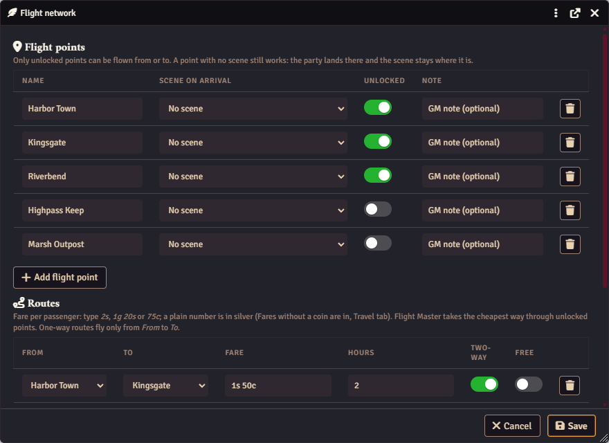

# Travel

[Back to the README](../README.md)

Getting the party from place to place: hex-by-hex overland travel, flights between flight points, travel pace and riding.

- [Hex Travel](#hex-travel)
- [Flight Master](#flight-master): [the network editor](#the-flight-network-editor), [flying](#flying), [route map](#route-map), [map background](#map-background), [discoveries and time](#discoveries-and-time)
- [Travel pace](#travel-pace)
- [Riding Training and Long Road](#riding-training-and-long-road)
- [Cost and time before travel](#cost-and-time-before-travel)

Settings for all of these are on the control panel's **Travel** tab.

## Hex Travel

**How to use:** run the **Hex Travel** macro (GM only). You need at least one encounter zone first: **control panel › Travel › Encounter zones**, with **Add zone** (a zone name and the roll table its encounters come from).

The window asks for the **Zone**, the number of **Road hexes** and **Off-road hexes**, the **Pace** and whether the party is **Mounted**, then you click **Travel**. One hex is one mile.

- Roads are safe. Each off-road hex takes longer (*Off-road hexes take*, 2 times by default) and rolls the *Encounter die*: a 1 is an encounter, drawn from the zone's roll table.
- Mounted travel multiplies the speed (*Riding speeds travel up by*). With [Riding Training](#riding-training-and-long-road), the *Mounted* box starts ticked only when every party member has the feat.
- The trip advances world time, is written to the **Travel Log** page of the tracker journal, whispers the trip and any encounters to the GM, and posts a short line to chat.
- Choosing "Other (no encounter table)" as the zone still moves time; any encounter roll just says "no table for this zone".
- Speeds come from the *Slow / Normal / Fast pace* settings (Travel › Advanced). With [Travel pace](#travel-pace) on, the pace is the party's pace.

## Flight Master

**How to use:** click the feather button in the token controls (or run the **Flight Master** macro), pick From, To and the number of passengers, then click **Check route**. Set up your flight points and routes first, in **control panel › Travel › Flight network…**.

Flight Master flies the party between **flight points** along **routes** you set up in the module itself. Nothing is read from a journal page, and a flight point opens a scene only if you pick one for it.

### The flight network editor

Open **control panel › Travel › Flight network…**. It has two tables and **Save** / **Cancel**; nothing changes until you save.

- **Flight points:** a name (for example *Harbor Town*), the **scene on arrival** (a dropdown of your scenes, or *No scene*), an **Unlocked** switch, an optional GM note, and a remove button. **Add flight point** adds a row. Only unlocked points can be flown from or to.
- **Routes:** **From** and **To** (dropdowns of your flight points), the **fare** per passenger, the flight **hours**, a **Two-way** switch (off: the route only flies From → To) and a **Free** switch (nobody pays for this route, players included). Type fares with coins, like `2s`, `1g 20s` or `75c`; a plain number such as `2` is read in *Fares without a coin are in* (control panel › Travel, gold by default). The fare is shown back formatted when you leave the field.

Problems show under the tables as you type, and the rows are outlined: a point with no name or the same name as another, a route from a point to itself, a route naming a point that no longer exists, or a fare that can't be read stop **Save**; a route listed twice is only a warning (the cheaper one is flown). Removing a flight point asks first and removes its routes too.

Flight Master always takes the cheapest way through unlocked points, so the party can fly *Harbor Town → Hill Fort → River Camp* in one booking if each leg is a route.

### Flying

Open Flight Master from the feather button in the token controls or the **Flight Master** macro. Pick From, To and the number of passengers, then **Check route**: before anyone confirms, the window shows the route, the fare per passenger × passengers = total, the party purse and the flight time. Confirming charges the fare from the party group actor's purse (with change), plays the departure sound, advances the world time by the flight's hours if *Flights advance world time* is on (off by default from 1.20), writes the trip to the Travel Log and posts "The party flies from … The party lands at *Harbor Town*." to chat.

- **A point with a scene:** that scene is activated on arrival (the GM can untick *Open destination scene for players*). If it can't be opened, the fare is refunded and the flight is called off.
- **A point with no scene** (or a scene that has been deleted): the flight still happens, the fare is charged, time passes and the trip is logged, but the scene stays where it is. The GM gets a whisper saying the party landed there and may need moving.

A flight is refused, with nothing charged, when the party can't afford it ("needs X, has Y (short Z)"), when a point isn't in the network or isn't unlocked, or when no route connects the two points.

**Free flight (GM).** The GM's Flight Master window has a **Free flight (no fare)** checkbox (off by default). A free flight skips the purse check and charges nothing; everything else happens as usual and the chat card and Travel Log say "free flight". Players never see the checkbox, and the GM's client ignores a "free" request in a player's booking: players always pay unless the route itself is marked **Free**.

**Players and Flight Master.** With *Players can book flights* on (the default, control panel › Travel), players get the feather button in the token controls and can drag the **Flight Master** macro onto their own hotbar from the *Wanderer's Toolkit Macros* compendium (or the shared world copy in the macro folder). Players see only the unlocked flight points and their routes; they never see your notes. A player picks a route and confirms; the active GM's client checks everything again (purse, points, routes), charges the fare and carries the flight out, and the player is told how it went. A GM must be connected ("A GM needs to be connected to fly.").

### Upgrading from 1.15 or earlier: the Flight Routes journal page

Earlier versions kept the network in two tables on the tracker journal's **Flight Routes** page. While the flight network is empty and that page has flight points, the editor and the Overview tab offer **Import from the Flight Routes journal page**. It asks first and lists anything worth a look:

- each point's scene is matched by its exact scene name; a name with no match (or more than one scene with that name) imports as *No scene*, to pick in the editor;
- fares are read exactly as before (coins, or plain numbers in the fare unit);
- every route imports as **Two-way**, because the old tables always flew both ways;
- rows naming an unknown point, or a point to itself, are skipped and listed.

The import never edits or deletes the page and never runs on its own. Once the flight network has flight points the page is ignored, and you may delete it.

For scripters

`api.flight()` opens Flight Master. `api.flight.network()` returns the network (`{ version, points: [{ id, name, sceneUuid, unlocked, note }], routes: [{ id, from, to, fareCp, hours, twoWay, free }] }`; `from` / `to` are point ids and `fareCp` is in the smallest coin in use). GM only: `api.flight.setNetwork(obj)` replaces it (points may be named by name in routes; a network with errors is refused), `api.flight.unlock("Hill Fort")` unlocks a point by name or id (`unlock(name, false)` locks it), `api.flight.fly(from, to, { pax, free, scene })` flies now without the window, `api.flight.importLegacy({ dryRun })` and `api.flight.editor()`.

Also `api.hexTravel()` (Hex Travel window), `api.flight.editor()` (the network editor), `api.flight.importLegacy({ dryRun: true })` (see what the old journal page would import), and a free flight from a macro: `api.flight.fly("Harbor Town", "Hill Fort", { free: true })`. More in the [scripting guide](scripting.md).

### Route map

With **Flight route map** on (Features tab), the token controls get a map button next to the feather (for players too), and there's a **Flight Route Map** macro and **control panel › Travel › Flight route map…**. The map draws each flight point as a dot and each route as a line (dotted for free routes, an arrow for one-way ones); hover a line for its hours and fare. A ring marks the point for the scene you're on.

- **Players** see the unlocked points and the routes between them. *Locked flight points on players' map* (Travel › Advanced) decides the rest: **Hidden** (default) leaves locked points off the map; **Greyed out, unnamed** shows them as *Unknown*, greyed, with their routes dashed and no fare or hours.
- **The GM** sees every point (locked ones marked) and can drag points around; **Save layout** stores the positions with the flight network, so players see the same map. **Arrange in a circle** spreads every point evenly. Points never placed are laid out on a circle.
- **Zoom and pan** (everyone; *Zoom and pan the route map*, Travel › Advanced, on): the mouse wheel zooms around the cursor (half size to four times) and dragging the empty map moves it; **Reset view** goes back. The GM can still drag points at any zoom, and **Save layout** stores the same positions. Only that window's view changes; nothing is saved, and the background picture zooms with the points.

### Map background

With **Flight map background** on (needs the route map), a picture of your own (from your world's files, for example a map of your continent) sits behind the flight route map for everyone who opens it. Set the picture, its fit (inside / fill / stretch), scale, offset and opacity under control panel › Travel › Advanced, then drag the flight points onto the picture and click **Save layout**. With no picture the map is unchanged. One picture per world.

### Discoveries and time

- **Discovered!** When a GM unlocks a flight point (the editor's Unlocked switch, then Save), chat says "Discovered! New flight point: *name*." for everyone. Switch it off with *Announce new flight points* (Travel › Advanced). The first save of a new network and the import from the old journal page announce nothing.
- **Flights advance world time** (Travel › Advanced, **off** by default): on arrival, world time moves on by the flight's hours, so a calendar module that follows world time follows the flight. Before 1.20 every flight did this; the 1.20 update notes card has a **Keep flights advancing world time** button for worlds that want to keep it.

**Flight sound.** A short departure clip that comes with the module plays for everyone when a flight departs. Pick a different file in *Departure sound* (control panel › Travel › Advanced), or clear it for silence.

## Travel pace

**How to use:** run the **Travel Pace** macro (or **control panel › Travel › Travel pace…**) to set the party's pace. Players open the same window to ask for one.

With **Travel pace** on (it needs Hex Travel), the party has a pace: **fast**, **normal** or **slow (careful)**. The effects follow the SRD 5.2 travel pace rules, in the module's words:

| Pace | Distance (SRD) | While travelling |
| --- | --- | --- |
| Fast | 4 miles an hour, 30 a day | Disadvantage on Perception, Survival and Stealth checks |
| Normal | 3 miles an hour, 24 a day | Disadvantage on Stealth checks |
| Slow (careful) | 2 miles an hour, 18 a day | Advantage on Perception and Survival checks |

Hex Travel's speed still comes from the *Slow / Normal / Fast pace* settings (Travel › Advanced), so a world that changed them keeps its numbers. Nothing is rolled or enforced: the effect is named in Hex Travel's pace list, in the GM's trip summary and in the chat line, for you to apply.

- **The GM** sets the pace in the **Travel Pace** window (the **Travel Pace** macro, or *control panel › Travel › Travel pace…*), which posts "The party travels at … pace" with its effect. Picking another pace in Hex Travel sets it too.
- **Players** open the same window (the macro is shared with them) and **Ask the GM**: the GMs get a whisper with a **Set … pace** button. With *Players can ask for a travel pace* off, players just see the current pace.

Without Travel pace, Hex Travel's pace list is as before. There's no hex trail.

## Riding Training and Long Road

**How to use:** click **Run setup**, then drag the *Riding Training* feat from the Items directory (*Wanderer's Toolkit* folder) onto each character who has learned to ride.

**Run setup** adds a feat called *Riding Training* to an Items folder named *Wanderer's Toolkit* (players can see it, so they can drag it onto their sheets). It's granted on completing riding training with a stablemaster or riding instructor:

> **Swift Mount.** Mounting or dismounting a creature costs you only 5 feet of movement, rather than half your Speed.
> **Long Road.** When every member of your party has this feat and all of you are mounted, the party travels overland at mounted speed.

Hex Travel enforces Long Road: when the party actor has members, the *Mounted* box starts ticked only if every member has the feat, and the dialog names anyone who doesn't. The GM can still tick or untick it. Rename the feat in the **Riding feat name** setting if you call it something else.

**Upgrading from 1.7 or earlier.** The feat used to be called *Trained Rider*. Hex Travel accepts either name, and a *Riding feat name* setting still holding *Trained Rider* is read as *Riding Training*. Run setup once to rename the module's own *Trained Rider* feats (in the Items directory and on actors) to *Riding Training*; a feat you renamed yourself is left alone.

## Cost and time before travel

With *Cost and time before travel* on, Hex Travel and flights (GM and players' bookings) show a confirm with the **cost** in gold, silver and copper, the **time** and **who pays** (the party actor; free flights and hex travel cost nothing). The GM can skip it with *Travel without the cost and time check* (Travel › Advanced; a player's booking still shows its confirm).
